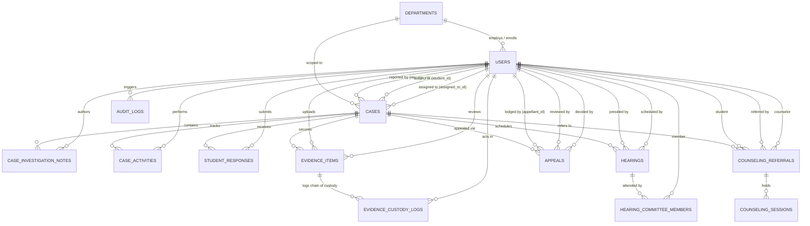

# CIVNEXA — Relational Database Architecture & Schema Design (BE-1.2)

**Document Reference:** `backend/docs/BE1_2_DATABASE_DESIGN.md`  
**Application Name:** CIVNEXA  
**Tagline:** Report. Verify. Support. Resolve.  
**Domain Scope:** Relational Schema Architecture, MySQL 8 / Hibernate 7 JPA Entity Specifications, Flyway Migration Strategy & Confidentiality Boundaries  
**Date:** October 29, 2026  
**Status:** **APPROVED FOR IMPLEMENTATION**

---

## 1. Executive Summary & Design Principles

CIVNEXA is an enterprise-grade institutional conduct, grievance, safety, and student support system. The relational schema is engineered to satisfy the rigorous compliance, auditability, and role-based confidentiality requirements of higher-education institutions.

### Core Design Principles
1. **Surrogate Technical Keys with Business Reference Numbers:** Every relational entity uses a 64-bit integer (`BIGINT AUTO_INCREMENT`) primary key for efficient joins and index traversals, paired with an indexed, human-readable institutional reference number (e.g. `CX-2026-0109`, `GRV-2026-0042`, `EV-2026-001`, `H-2026-001`, `APL-2026-001`, `REF-2026-001`).
2. **Consolidated Incident & Grievance Lifecycle:** Rather than bifurcating common investigation workflows across separate tables, `cases` serves as the authoritative single table for both disciplinary incidents and student grievances via `case_type` (`INCIDENT` vs `GRIEVANCE`). This eliminates duplication across evidence vaults, hearings, timelines, and appellate reviews.
3. **Strict Confidentiality Boundaries:** Student counseling records and clinical session impressions are partitioned with dedicated access controls. Clinical notes (`confidential_notes`) are accessible only by the Welfare Coordinator, Dean, and Super Administrator, completely isolated from general case review queries.
4. **Append-Only Immutable Ledgers:** Audit events (`audit_logs`) and evidence chain of custody entries (`evidence_custody_logs`) are modeled as append-only structures with foreign key constraints, timestamps, and actor attributions.
5. **No Blind Deletions:** Institutional conduct, evidence, and appeals require statutory retention. Foreign keys specify `ON DELETE RESTRICT` or `ON DELETE NO ACTION` on critical domain records to prevent accidental cascade deletion.

---

## 2. Entity-Relationship Diagram (ERD)

---

## 3. Entity Specifications & Table Definitions

### 3.1 `departments` (Academic & Administrative Departments)
Represents institutional faculties, academic branches, and administrative secretariats.

| Column | Type | Nullable | Constraints & Description |
| :--- | :--- | :--- | :--- |
| `id` | `BIGINT` | NO | Primary Key, `AUTO_INCREMENT` |
| `code` | `VARCHAR(30)` | NO | Unique institutional code (e.g., `CSE`, `ME`, `ECE`) |
| `name` | `VARCHAR(150)` | NO | Full department name |
| `hod_name` | `VARCHAR(100)` | YES | Designated Head of Department name |
| `contact_email` | `VARCHAR(120)` | YES | Official department contact email |
| `status` | `VARCHAR(20)` | NO | Default `'ACTIVE'`. Values: `ACTIVE`, `INACTIVE` |
| `description` | `TEXT` | YES | Department overview and program description |
| `created_at` | `TIMESTAMP` | NO | Record creation timestamp |
| `updated_at` | `TIMESTAMP` | NO | Last modification timestamp |

* **Indexes:** `idx_dept_code (code)` (Unique), `idx_dept_status (status)`.

---

### 3.2 `users` (Institutional Identities, Roles & Student Profiles)
Unified identity entity supporting all 8 CIVNEXA institutional personas.

| Column | Type | Nullable | Constraints & Description |
| :--- | :--- | :--- | :--- |
| `id` | `BIGINT` | NO | Primary Key, `AUTO_INCREMENT` |
| `user_reference` | `VARCHAR(30)` | NO | Unique public reference (e.g. `USR-001`, `STU-8821`) |
| `name` | `VARCHAR(100)` | NO | Full legal or registered institutional name |
| `email` | `VARCHAR(120)` | NO | Unique institutional email address (normalized lower-case) |
| `password_hash` | `VARCHAR(255)` | NO | BCrypt password hash (never serialized in DTOs) |
| `role` | `VARCHAR(30)` | NO | Enum: `SUPER_ADMIN`, `DEAN`, `HOD`, `FACULTY`, `STAFF`, `COORDINATOR`, `COMMITTEE_MEMBER`, `STUDENT` |
| `department_id` | `BIGINT` | YES | FK to `departments.id` (`ON DELETE SET NULL`) |
| `title` | `VARCHAR(150)` | YES | Academic/professional designation (e.g. "Dean of Student Affairs") |
| `phone` | `VARCHAR(30)` | YES | Contact telephone number |
| `avatar` | `VARCHAR(10)` | YES | Two-letter initials or avatar token |
| `status` | `VARCHAR(20)` | NO | Default `'ACTIVE'`. Values: `ACTIVE`, `DEACTIVATED`, `SUSPENDED` |
| `roll_number` | `VARCHAR(30)` | YES | Student Roll Number (Unique when non-null) |
| `enrollment_number` | `VARCHAR(50)` | YES | University Enrollment Identifier (Unique when non-null) |
| `course` | `VARCHAR(100)` | YES | Degree program (e.g. "B.Tech Computer Science") |
| `semester` | `VARCHAR(30)` | YES | Current semester (e.g. "Semester 5") |
| `section` | `VARCHAR(10)` | YES | Section designation (e.g. "A") |
| `cgpa` | `DECIMAL(4,2)` | YES | Academic standing (e.g. `7.82`) |
| `hostel_details` | `VARCHAR(150)` | YES | Residential hostel block & room |
| `created_at` | `TIMESTAMP` | NO | Record creation timestamp |
| `updated_at` | `TIMESTAMP` | NO | Last modification timestamp |

* **Indexes:** `idx_user_ref (user_reference)` (Unique), `idx_user_email (email)` (Unique), `idx_user_role (role)`, `idx_user_roll (roll_number)` (Unique), `idx_user_dept (department_id)`.

---

### 3.3 `cases` (Disciplinary Incidents & Student Grievances)
Consolidated case registry accommodating multi-step incident reports and formal grievances.

| Column | Type | Nullable | Constraints & Description |
| :--- | :--- | :--- | :--- |
| `id` | `BIGINT` | NO | Primary Key, `AUTO_INCREMENT` |
| `case_number` | `VARCHAR(30)` | NO | Unique reference number (e.g. `CX-2026-0109`, `GRV-2026-0042`) |
| `case_type` | `VARCHAR(20)` | NO | Enum: `INCIDENT` (reported on student) or `GRIEVANCE` (submitted by student) |
| `title` | `VARCHAR(255)` | NO | Incident or grievance subject line |
| `category` | `VARCHAR(50)` | NO | Enum `CaseCategory`: `EXAM_INCIDENT`, `CAMPUS_SAFETY`, `ANTI_RAGGING`, `ACADEMIC_GRIEVANCE`, `DISCIPLINE`, `HOSTEL_ISSUE`, `FACULTY_GRIEVANCE`, `INFRASTRUCTURE`, `OTHER` |
| `subcategory` | `VARCHAR(100)` | YES | Granular incident classification |
| `priority` | `VARCHAR(20)` | NO | Default `'MEDIUM'`. Enum: `LOW`, `MEDIUM`, `HIGH`, `CRITICAL` |
| `status` | `VARCHAR(40)` | NO | Default `'PENDING_VERIFICATION'`. Enum `CaseStatus`: `SUBMITTED`, `PENDING_VERIFICATION`, `VERIFIED`, `ASSIGNED`, `UNDER_INVESTIGATION`, `AWAITING_RESPONSE`, `HEARING_SCHEDULED`, `DECISION_PENDING`, `RESOLVED`, `CLOSED`, `RETURNED_FOR_INFORMATION`, `REJECTED`, `ESCALATED` |
| `verification_status` | `VARCHAR(20)` | NO | Default `'PENDING'`. Enum: `PENDING`, `VERIFIED`, `REJECTED`, `RETURNED` |
| `department_id` | `BIGINT` | YES | FK to `departments.id` |
| `student_id` | `BIGINT` | YES | FK to `users.id` (Subject of incident or complainant) |
| `reporter_id` | `BIGINT` | YES | FK to `users.id` (Null for anonymous grievances) |
| `assigned_to_id` | `BIGINT` | YES | FK to `users.id` (Assigned proctor, committee member, or HOD) |
| `incident_date` | `TIMESTAMP` | YES | Date and time the event occurred |
| `incident_time` | `VARCHAR(10)` | YES | Approximate time string (e.g. `14:30`) |
| `location` | `VARCHAR(150)` | YES | Location on campus |
| `summary` | `TEXT` | NO | Full factual statement / narrative |
| `remarks` | `TEXT` | YES | Additional confidential remarks |
| `is_confidential` | `BOOLEAN` | NO | Default `FALSE`. Masks student identity to unauthorized roles |
| `is_anonymous` | `BOOLEAN` | NO | Default `FALSE`. Enforces anonymous whistleblower protection |
| `concerned_person` | `VARCHAR(150)` | YES | Faculty/staff member named in grievance |
| `next_action_deadline`| `TIMESTAMP` | YES | Statutory resolution or inquiry deadline |
| `created_at` | `TIMESTAMP` | NO | Submission timestamp |
| `updated_at` | `TIMESTAMP` | NO | Last update timestamp |

* **Indexes:** `idx_case_number (case_number)` (Unique), `idx_case_status (status)`, `idx_case_type (case_type)`, `idx_case_category (category)`, `idx_case_student (student_id)`, `idx_case_reporter (reporter_id)`, `idx_case_assigned (assigned_to_id)`, `idx_case_dept (department_id)`.

---

### 3.4 `case_investigation_notes` (Investigation & Deliberation Notes)
Chronological investigator notes recorded during formal inquiry.

| Column | Type | Nullable | Constraints & Description |
| :--- | :--- | :--- | :--- |
| `id` | `BIGINT` | NO | Primary Key, `AUTO_INCREMENT` |
| `case_id` | `BIGINT` | NO | FK to `cases.id` (`ON DELETE CASCADE`) |
| `author_id` | `BIGINT` | NO | FK to `users.id` |
| `note` | `TEXT` | NO | Detailed investigation findings or procedural note |
| `is_confidential` | `BOOLEAN` | NO | Default `FALSE`. Limits view to Dean and Board |
| `created_at` | `TIMESTAMP` | NO | Note creation timestamp |

* **Indexes:** `idx_note_case (case_id)`, `idx_note_author (author_id)`.

---

### 3.5 `student_responses` (Student Explanations & Defenses)
Formal response submitted by a student when a case is in `AWAITING_RESPONSE`.

| Column | Type | Nullable | Constraints & Description |
| :--- | :--- | :--- | :--- |
| `id` | `BIGINT` | NO | Primary Key, `AUTO_INCREMENT` |
| `case_id` | `BIGINT` | NO | FK to `cases.id` (`ON DELETE CASCADE`) |
| `student_id` | `BIGINT` | NO | FK to `users.id` |
| `response_text` | `TEXT` | NO | Student's formal defense statement |
| `declaration_confirmed` | `BOOLEAN` | NO | Explicit statement of truth acknowledgement |
| `submitted_at` | `TIMESTAMP` | NO | Submission timestamp |

* **Indexes:** `idx_resp_case (case_id)`, `idx_resp_student (student_id)`.

---

### 3.6 `case_activities` (Chronological Workflow Activity Log)
Internal procedural transition log tracking status changes and governance actions.

| Column | Type | Nullable | Constraints & Description |
| :--- | :--- | :--- | :--- |
| `id` | `BIGINT` | NO | Primary Key, `AUTO_INCREMENT` |
| `case_id` | `BIGINT` | NO | FK to `cases.id` (`ON DELETE CASCADE`) |
| `action` | `VARCHAR(100)` | NO | Action name (e.g. `CASE_CREATED`, `STATUS_CHANGED`, `HEARING_SCHEDULED`) |
| `actor_id` | `BIGINT` | YES | FK to `users.id` |
| `actor_name` | `VARCHAR(100)` | NO | Denormalized actor name for historical preservation |
| `actor_role` | `VARCHAR(30)` | NO | Denormalized actor role at time of action |
| `previous_status` | `VARCHAR(50)` | YES | Prior status string |
| `new_status` | `VARCHAR(50)` | YES | Resulting status string |
| `details` | `TEXT` | YES | Action commentary or statutory rationale |
| `timestamp` | `TIMESTAMP` | NO | Action timestamp |

* **Indexes:** `idx_act_case (case_id)`, `idx_act_timestamp (timestamp)`.

---

### 3.7 `evidence_items` (Evidence Vault & Digital Exhibits)
Secure metadata records for physical and digital exhibits attached to cases.

| Column | Type | Nullable | Constraints & Description |
| :--- | :--- | :--- | :--- |
| `id` | `BIGINT` | NO | Primary Key, `AUTO_INCREMENT` |
| `evidence_reference` | `VARCHAR(50)` | NO | Unique exhibit reference (e.g. `EV-2026-001`) |
| `case_id` | `BIGINT` | NO | FK to `cases.id` (`ON DELETE RESTRICT`) |
| `uploader_id` | `BIGINT` | NO | FK to `users.id` |
| `file_name` | `VARCHAR(255)` | NO | Original file name |
| `file_type` | `VARCHAR(100)` | NO | MIME type (e.g. `application/pdf`, `image/jpeg`) |
| `file_size_bytes` | `BIGINT` | NO | File size in bytes |
| `storage_reference` | `VARCHAR(500)` | NO | Relative storage path or S3/GCS bucket reference URI |
| `sha256_checksum` | `VARCHAR(64)` | NO | Cryptographic SHA-256 hex digest for integrity verification |
| `review_status` | `VARCHAR(20)` | NO | Default `'PENDING'`. Enum: `PENDING`, `REVIEWED`, `FLAGGED` |
| `reviewed_by_id` | `BIGINT` | YES | FK to `users.id` |
| `reviewed_at` | `TIMESTAMP` | YES | Timestamp of review decision |
| `review_notes` | `TEXT` | YES | Board reviewer evaluation notes |
| `is_confidential` | `BOOLEAN` | NO | Default `FALSE`. Masks exhibit from non-committee members |
| `uploaded_at` | `TIMESTAMP` | NO | Upload timestamp |

* **Indexes:** `idx_ev_ref (evidence_reference)` (Unique), `idx_ev_case (case_id)`, `idx_ev_uploader (uploader_id)`, `idx_ev_status (review_status)`.

---

### 3.8 `evidence_custody_logs` (Chain of Custody Ledger)
Append-only legal chain of custody audit log for exhibits.

| Column | Type | Nullable | Constraints & Description |
| :--- | :--- | :--- | :--- |
| `id` | `BIGINT` | NO | Primary Key, `AUTO_INCREMENT` |
| `evidence_id` | `BIGINT` | NO | FK to `evidence_items.id` (`ON DELETE RESTRICT`) |
| `actor_id` | `BIGINT` | NO | FK to `users.id` |
| `action` | `VARCHAR(100)` | NO | Action (e.g. `UPLOADED`, `VERIFIED`, `STATUS_UPDATED`, `ACCESSED`) |
| `details` | `TEXT` | YES | Cryptographic check result or procedural context |
| `timestamp` | `TIMESTAMP` | NO | Event timestamp |

* **Indexes:** `idx_custody_ev (evidence_id)`, `idx_custody_time (timestamp)`.

---

### 3.9 `hearings` (Proctorial Hearings & Committee Deliberations)
Scheduled board proceedings, summonses, and formal outcome deliberations.

| Column | Type | Nullable | Constraints & Description |
| :--- | :--- | :--- | :--- |
| `id` | `BIGINT` | NO | Primary Key, `AUTO_INCREMENT` |
| `hearing_number` | `VARCHAR(30)` | NO | Unique reference (e.g. `H-2026-001`) |
| `case_id` | `BIGINT` | NO | FK to `cases.id` (`ON DELETE RESTRICT`) |
| `scheduled_by_id` | `BIGINT` | NO | FK to `users.id` |
| `presiding_authority_id` | `BIGINT` | NO | FK to `users.id` (Dean or Proctorial Board Chair) |
| `hearing_date` | `DATE` | NO | Scheduled session date |
| `start_time` | `TIME` | NO | Start time |
| `end_time` | `TIME` | NO | Scheduled end time |
| `venue` | `VARCHAR(150)` | NO | Physical conference room or virtual link |
| `mode` | `VARCHAR(30)` | NO | Default `'IN_PERSON'`. Values: `IN_PERSON`, `VIRTUAL`, `HYBRID` |
| `status` | `VARCHAR(30)` | NO | Default `'SCHEDULED'`. Enum: `SCHEDULED`, `IN_PROGRESS`, `CONCLUDED`, `RESCHEDULED`, `CANCELLED` |
| `remarks` | `TEXT` | YES | Scheduling instructions or preliminary notes |
| `outcome` | `TEXT` | YES | Formal board sanction recommendation or dismissal |
| `minutes_draft` | `TEXT` | YES | Contemporaneous hearing minutes transcript |
| `minutes_finalized_at`| `TIMESTAMP` | YES | Timestamp when minutes were officially confirmed |
| `created_at` | `TIMESTAMP` | NO | Creation timestamp |
| `updated_at` | `TIMESTAMP` | NO | Last update timestamp |

* **Indexes:** `idx_hearing_num (hearing_number)` (Unique), `idx_hearing_case (case_id)`, `idx_hearing_date (hearing_date)`, `idx_hearing_venue (venue)`.

---

### 3.10 `hearing_committee_members` (Hearing Panel Attendees)
Associates faculty and board reviewers with scheduled hearings.

| Column | Type | Nullable | Constraints & Description |
| :--- | :--- | :--- | :--- |
| `id` | `BIGINT` | NO | Primary Key, `AUTO_INCREMENT` |
| `hearing_id` | `BIGINT` | NO | FK to `hearings.id` (`ON DELETE CASCADE`) |
| `member_id` | `BIGINT` | NO | FK to `users.id` |
| `attendance_status` | `VARCHAR(20)` | NO | Default `'PENDING'`. Enum: `PENDING`, `PRESENT`, `ABSENT`, `EXCUSED` |

* **Indexes:** `idx_hcm_hearing (hearing_id)`, `idx_hcm_member (member_id)`, `uq_hearing_member (hearing_id, member_id)` (Unique).

---

### 3.11 `appeals` (Appellate Reviews & Reconsideration Petitions)
Independent petitions for reconsideration of proctorial determinations.

| Column | Type | Nullable | Constraints & Description |
| :--- | :--- | :--- | :--- |
| `id` | `BIGINT` | NO | Primary Key, `AUTO_INCREMENT` |
| `appeal_number` | `VARCHAR(30)` | NO | Unique appellate docket (e.g. `APL-2026-001`) |
| `case_id` | `BIGINT` | NO | FK to `cases.id` (`ON DELETE RESTRICT`) |
| `appellant_id` | `BIGINT` | NO | FK to `users.id` (Student lodging appeal) |
| `assigned_reviewer_id` | `BIGINT` | YES | FK to `users.id` (Dean or Designated Appellate Officer) |
| `status` | `VARCHAR(40)` | NO | Default `'SUBMITTED'`. Enum `AppealStatus`: `DRAFT`, `SUBMITTED`, `UNDER_REVIEW`, `ADDITIONAL_INFORMATION_REQUESTED`, `REVIEW_COMPLETED`, `UPHELD`, `MODIFIED`, `REMANDED_FOR_REVIEW`, `WITHDRAWN` |
| `grounds` | `VARCHAR(255)` | NO | Comma-separated or serialized statutory grounds |
| `explanation` | `TEXT` | NO | Detailed appellant legal/factual arguments (min 20 chars) |
| `relief_sought` | `TEXT` | NO | Desired remedy or sanction mitigation request |
| `original_decision_summary` | `TEXT` | NO | Verbatim summary of preserved original decision |
| `original_decision_date` | `TIMESTAMP` | YES | Date original sanction was imposed |
| `original_sanction_type` | `VARCHAR(50)` | YES | Category of sanction challenged |
| `appeal_deadline` | `TIMESTAMP` | NO | Statutory deadline for filing review |
| `submitted_at` | `TIMESTAMP` | NO | Submission timestamp |
| `recommendation` | `TEXT` | YES | Appellate committee recommendation |
| `final_outcome` | `TEXT` | YES | Final signed determination |
| `decided_at` | `TIMESTAMP` | YES | Date outcome finalized |
| `decided_by_id` | `BIGINT` | YES | FK to `users.id` |
| `created_at` | `TIMESTAMP` | NO | Creation timestamp |
| `updated_at` | `TIMESTAMP` | NO | Last update timestamp |

* **Indexes:** `idx_appeal_num (appeal_number)` (Unique), `idx_appeal_case (case_id)`, `idx_appeal_appellant (appellant_id)`, `idx_appeal_status (status)`.

---

### 3.12 `counseling_referrals` (Student Welfare & Counseling Referrals)
Confidential referrals originating from disciplinary cases or direct academic mentoring.

| Column | Type | Nullable | Constraints & Description |
| :--- | :--- | :--- | :--- |
| `id` | `BIGINT` | NO | Primary Key, `AUTO_INCREMENT` |
| `referral_number` | `VARCHAR(30)` | NO | Unique referral reference (e.g. `REF-2026-001`) |
| `case_id` | `BIGINT` | YES | Optional FK to `cases.id` (if referred from a case) |
| `student_id` | `BIGINT` | NO | FK to `users.id` (Student recipient) |
| `referred_by_id` | `BIGINT` | NO | FK to `users.id` (Referring faculty, HOD, or Dean) |
| `counselor_id` | `BIGINT` | YES | FK to `users.id` (Assigned Psychologist / Coordinator) |
| `reason` | `TEXT` | NO | Intake justification / behavioral referral reason |
| `priority` | `VARCHAR(20)` | NO | Default `'MEDIUM'`. Enum: `LOW`, `MEDIUM`, `HIGH`, `CRITICAL` |
| `status` | `VARCHAR(30)` | NO | Default `'SCHEDULED'`. Enum: `SCHEDULED`, `IN_PROGRESS`, `COMPLETED`, `CANCELLED` |
| `scheduled_date` | `DATE` | YES | First intake session target date |
| `confidential_notes` | `TEXT` | YES | **Strict Confidentiality:** Protected clinical counseling notes |
| `completed_at` | `TIMESTAMP` | YES | Discharge / closure timestamp |
| `created_at` | `TIMESTAMP` | NO | Creation timestamp |
| `updated_at` | `TIMESTAMP` | NO | Last update timestamp |

* **Indexes:** `idx_couns_ref (referral_number)` (Unique), `idx_couns_student (student_id)`, `idx_couns_counselor (counselor_id)`, `idx_couns_case (case_id)`, `idx_couns_status (status)`.

---

### 3.13 `counseling_sessions` (Counseling Attendance & Clinical Progress)
Individual session tracking with attendance recording.

| Column | Type | Nullable | Constraints & Description |
| :--- | :--- | :--- | :--- |
| `id` | `BIGINT` | NO | Primary Key, `AUTO_INCREMENT` |
| `referral_id` | `BIGINT` | NO | FK to `counseling_referrals.id` (`ON DELETE CASCADE`) |
| `session_number` | `INT` | NO | Sequential appointment count |
| `session_date` | `DATE` | NO | Appointment date |
| `attendance_status` | `VARCHAR(20)` | NO | Default `'SCHEDULED'`. Enum: `SCHEDULED`, `ATTENDED`, `MISSED`, `RESCHEDULED` |
| `clinical_summary` | `TEXT` | YES | Professional impression and recommended exercises |
| `created_at` | `TIMESTAMP` | NO | Session record timestamp |

* **Indexes:** `idx_csess_ref (referral_id)`, `idx_csess_date (session_date)`.

---

### 3.14 `audit_logs` (System-Wide Security & Compliance Audit Log)
Append-only system-level audit trail for regulatory compliance.

| Column | Type | Nullable | Constraints & Description |
| :--- | :--- | :--- | :--- |
| `id` | `BIGINT` | NO | Primary Key, `AUTO_INCREMENT` |
| `event_uuid` | `VARCHAR(36)` | NO | Unique RFC 4122 UUID |
| `action` | `VARCHAR(100)` | NO | Action verb (e.g. `USER_ACTIVATED`, `PERMISSION_TOGGLED`, `CASE_CREATED`) |
| `entity_type` | `VARCHAR(50)` | NO | Target entity category (e.g. `USER`, `CASE`, `EVIDENCE`, `HEARING`) |
| `entity_id` | `VARCHAR(100)` | NO | Business or surrogate key of target |
| `actor_id` | `BIGINT` | YES | FK to `users.id` (Null for automated system actions) |
| `actor_name` | `VARCHAR(100)` | NO | Preserved actor name |
| `actor_role` | `VARCHAR(30)` | NO | Preserved actor role |
| `previous_status` | `VARCHAR(50)` | YES | Prior state |
| `new_status` | `VARCHAR(50)` | YES | Resulting state |
| `description` | `TEXT` | NO | Factual narrative of modification |
| `ip_address` | `VARCHAR(45)` | YES | IPv4 / IPv6 network address |
| `timestamp` | `TIMESTAMP` | NO | Event occurrence timestamp |

* **Indexes:** `idx_audit_uuid (event_uuid)` (Unique), `idx_audit_entity (entity_type, entity_id)`, `idx_audit_actor (actor_id)`, `idx_audit_timestamp (timestamp)`.

---

### 3.15 `import_jobs` (Bulk User Provisioning Jobs)
Tracks administrative bulk user upload jobs across XLSX, CSV, and JSON formats.

| Column | Type | Nullable | Constraints & Description |
| :--- | :--- | :--- | :--- |
| `id` | `BIGINT` | NO | Primary Key, `AUTO_INCREMENT` |
| `job_reference` | `VARCHAR(50)` | NO | Unique import identifier (e.g. `IMP-2026-0001`) |
| `initiated_by_id` | `BIGINT` | YES | FK to `users.id` (`ON DELETE SET NULL`) |
| `import_type` | `VARCHAR(40)` | NO | Enum: `STUDENT_ROSTER`, `FACULTY_ROSTER`, `STAFF_ROSTER`, `GENERAL_USERS` |
| `file_name` | `VARCHAR(255)` | NO | Original file name uploaded |
| `file_format` | `VARCHAR(20)` | NO | Enum: `XLSX`, `CSV`, `JSON` |
| `file_size_bytes` | `BIGINT` | NO | File size in bytes |
| `file_checksum` | `VARCHAR(64)` | YES | SHA-256 cryptographic digest of uploaded file |
| `status` | `VARCHAR(30)` | NO | Default `'PENDING'`. Enum: `PENDING`, `PROCESSING`, `COMPLETED`, `FAILED`, `PARTIALLY_COMPLETED` |
| `total_records` | `INT` | NO | Total records parsed |
| `processed_records` | `INT` | NO | Successfully provisioned records count |
| `failed_records` | `INT` | NO | Failed records count |
| `skipped_records` | `INT` | NO | Skipped records count (e.g. header rows or blank lines) |
| `summary` | `TEXT` | YES | Processing outcome or error overview |
| `created_at` | `TIMESTAMP` | NO | Job submission timestamp |
| `started_at` | `TIMESTAMP` | YES | Batch processing start timestamp |
| `completed_at` | `TIMESTAMP` | YES | Batch completion timestamp |

* **Indexes:** `idx_import_job_ref (job_reference)` (Unique), `idx_import_job_admin (initiated_by_id)`, `idx_import_job_status (status)`, `idx_import_job_created (created_at)`.

---

### 3.16 `import_row_results` (Row-Level Diagnostics & Errors)
Maintains row-by-row processing audit and validation error diagnostics.

| Column | Type | Nullable | Constraints & Description |
| :--- | :--- | :--- | :--- |
| `id` | `BIGINT` | NO | Primary Key, `AUTO_INCREMENT` |
| `job_id` | `BIGINT` | NO | FK to `import_jobs.id` (`ON DELETE CASCADE`) |
| `row_number` | `INT` | NO | 1-based source file line or row index |
| `record_identifier` | `VARCHAR(120)` | YES | User identifier (email, roll number, or employee ID) |
| `status` | `VARCHAR(20)` | NO | Enum: `SUCCESS`, `FAILED`, `SKIPPED` |
| `error_message` | `TEXT` | YES | Detailed validation or parsing failure message |
| `error_code` | `VARCHAR(50)` | YES | Machine-readable failure reason (e.g. `DUPLICATE_EMAIL`, `INVALID_ROLE`) |
| `processed_at` | `TIMESTAMP` | NO | Row evaluation timestamp |

* **Indexes:** `idx_import_row_job (job_id)`, `idx_import_row_status (status)`, `idx_import_row_ident (record_identifier)`.

---

## 4. Sensitive Fields & Access Governance

| Entity | Sensitive Column | Risk Assessment & Protection Control |
| :--- | :--- | :--- |
| `users` | `password_hash` | Security credential. Never serialized in JSON DTOs (`@JsonIgnore` and custom projection exclusion). |
| `cases` | `is_anonymous` / `reporter_id` | Whistleblower protection. When `is_anonymous = true`, API responses mask reporter details to all non-SuperAdmin callers. |
| `cases` | `is_confidential` / `student_id` | Protected conduct record. When `is_confidential = true`, student identity is masked to roles outside Dean, HOD, and Board. |
| `counseling_referrals` | `confidential_notes` | Medical / mental health confidentiality. Restricted strictly to Welfare Coordinator and Dean; excluded from general case queries. |
| `evidence_items` | `sha256_checksum` | Integrity reference. Validated via Web Crypto in frontend and Java SHA-256 in backend. |

---

## 5. Migration Strategy & Flyway Plan

* **Flyway Directory:** `backend/src/main/resources/db/migration/`
* **Migration Scripts:**
  - `V1__create_initial_schema.sql`: Initial 14 tables (Departments, Users, Cases, Notes, Responses, Activities, Evidence, Custody, Hearings, Committee Members, Appeals, Referrals, Sessions, Audit Logs).
  - `V2__add_user_import_tracking.sql`: Bulk user provisioning schema (Import Jobs and Import Row Results).
* **Execution Paradigm:**
  - In production (`prod` profile): Flyway applies migrations against MySQL 8; `spring.jpa.hibernate.ddl-auto=validate` confirms exact schema alignment.
  - In automated test suite (`test` profile): Flyway applies migrations against in-memory H2 (configured in MySQL compatibility mode) to verify DDL syntax deterministically.
