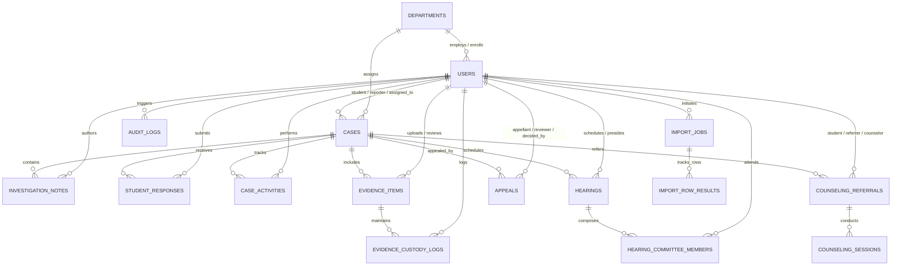

# CIVNEXA — Phase BE-1.2 Database Schema, JPA Entity Model & Flyway Migrations Implementation Report

**Project:** CIVNEXA — Campus Conduct, Grievance, Safety & Student Support Management System  
**Tagline:** Report. Verify. Support. Resolve.  
**Phase:** BE-1.2 — MySQL Database Schema, JPA Entity Model & Flyway Migrations  
**Repository:** `https://github.com/priyanshudubey8318/CIVNEXA.git`  
**Branch:** `main`  
**Execution Date:** October 30, 2026  
**Status:** COMPLETE & FULLY AUDITED (Awaiting Authorization for BE-1.3)

---

## 1. Executive Summary

Phase **BE-1.2** establishes the complete relational database architecture, Jakarta Persistence (JPA) entity model, Spring Data JPA repositories, and Flyway migration pipeline for CIVNEXA.

The schema comprehensively supports all core institutional conduct workflows, grievance tracking, evidence custody, disciplinary hearings, appellate reviews, counseling records, administrative compliance audit logging, institutional user registration support across all eight roles, and bulk user provisioning job tracking (`.xlsx`, `.csv`, `.json`).

All 16 tables, 16 JPA entities, 16 domain enums, and 16 repositories have been implemented and verified with strict Hibernate schema validation (`ddl-auto: validate`) against incremental Flyway migrations (`V1` and `V2`).

---

## 2. Git Checkpoints & Remote Synchronization

Development followed a strict commit-per-milestone paradigm pushed directly to `origin/main` on GitHub:

| Checkpoint | Commit Hash | Message | Description |
| :--- | :--- | :--- | :--- |
| **Checkpoint A** | `bf3b57c` | `docs(database): define CIVNEXA relational schema` | Database architecture document `BE1_2_DATABASE_DESIGN.md` with Mermaid ERD, table definitions, foreign keys, index specifications, and sensitive field protection rules. |
| **Checkpoint B** | `95517ef` | `feat(database): implement JPA entities and Spring Data repositories` | 14 initial Jakarta Persistence entities, 12 domain enums, and 14 Spring Data JPA repository interfaces. |
| **Checkpoint C** | `6c6e5b9` | `feat(database): configure Flyway migrations and MySQL baseline` | Flyway V1 DDL migration script (`V1__create_initial_schema.sql`), MySQL 8 and H2 datasource configuration, and Hibernate schema validation (`validate`). |
| **Checkpoint D** | `35386e5` | `test(database): verify schema migrations and entity persistence` | Initial integration test suite (`RepositoryIntegrationTests.java`), Department constructor ergonomics, frontend regression pass, and implementation report. |
| **Checkpoint E** | `0aebd32` | `feat(database): add user import tracking schema` | Bulk user provisioning schema: `ImportJob` and `ImportRowResult` entities, 4 enums (`ImportStatus`, `ImportType`, `ImportFileFormat`, `RowProcessingStatus`), 2 repositories, `V2__add_user_import_tracking.sql` migration, and import persistence tests. |
| **Checkpoint F** | `0f314ba` | `docs(database): finalize BE-1.2 implementation report and audit closeout` | Initial audit report, data integrity boundary analysis, and BE-1.2 phase closeout. |
| **Checkpoint G** | *(Current)* | `docs(database): complete BE-1.2 final documentation refinements` | Refined documentation accuracy regarding timestamps, checksum storage vs verification, import format tracking vs parsing, and Flyway baseline semantics. |

---

## 3. Relational Schema Architecture



### 3.1 Entity and Table Inventory (16 Tables / 16 Entities)

| Table | JPA Entity | Repository | Migration Script | Purpose |
| :--- | :--- | :--- | :--- | :--- |
| `departments` | `Department` | `DepartmentRepository` | `V1` | Institutional academic and administrative departments |
| `users` | `User` | `UserRepository` | `V1` | Institutional identities for all 8 roles with academic profiles |
| `cases` | `CaseRecord` | `CaseRecordRepository` | `V1` | Consolidated incidents (`INCIDENT`) and student grievances (`GRIEVANCE`) |
| `case_investigation_notes` | `InvestigationNote` | `InvestigationNoteRepository` | `V1` | Chronological formal inquiry findings with confidentiality flags |
| `student_responses` | `StudentResponse` | `StudentResponseRepository` | `V1` | Formal explanations, defenses, and truth declarations |
| `case_activities` | `CaseActivity` | `CaseActivityRepository` | `V1` | Procedural timeline tracking status transitions and actions |
| `evidence_items` | `EvidenceItem` | `EvidenceItemRepository` | `V1` | Physical and digital exhibits with SHA-256 cryptographic digests |
| `evidence_custody_logs` | `EvidenceCustodyLog` | `EvidenceCustodyLogRepository` | `V1` | Append-only chain of custody audit ledger |
| `hearings` | `Hearing` | `HearingRepository` | `V1` | Scheduled committee proceedings with dates, times, venues, and minutes |
| `hearing_committee_members` | `HearingCommitteeMember` | `HearingCommitteeMemberRepository` | `V1` | Panel composition, attendance records, and composite uniqueness |
| `appeals` | `AppealRecord` | `AppealRecordRepository` | `V1` | Appellate review petitions, statutory grounds, and determinations |
| `counseling_referrals` | `CounselingReferral` | `CounselingReferralRepository` | `V1` | Student welfare referrals with strictly isolated clinical notes |
| `counseling_sessions` | `CounselingSession` | `CounselingSessionRepository` | `V1` | Sequential counseling session records and attendance tracking |
| `audit_logs` | `AuditLog` | `AuditLogRepository` | `V1` | Regulatory compliance audit trail with UUIDs and IP logging |
| `import_jobs` | `ImportJob` | `ImportJobRepository` | `V2` | Bulk user provisioning batch tracking (XLSX, CSV, JSON) |
| `import_row_results` | `ImportRowResult` | `ImportRowResultRepository` | `V2` | Row-by-row diagnostic validation and error tracking |

---

## 4. User Registration & Bulk Import Database Support

### 4.1 Institutional User Registration Support
The database model natively supports account provisioning for all eight institutional roles:
- `SUPER_ADMIN`
- `DEAN`
- `HOD`
- `FACULTY`
- `STAFF`
- `COORDINATOR`
- `COMMITTEE_MEMBER`
- `STUDENT`

**Key Model Attributes:**
- `name`: Full legal institutional name (`VARCHAR(100) NOT NULL`).
- `email`: Normalized unique institutional email (`VARCHAR(120) NOT NULL UNIQUE`).
- `password_hash`: BCrypt security hash (`VARCHAR(255) NOT NULL`). Plaintext passwords are never stored.
- `role`: Strict enum constraint (`RoleType`).
- `department_id`: Foreign key association to `departments.id` (`ON DELETE SET NULL`).
- `user_reference`: Public reference identifier (`VARCHAR(30) NOT NULL UNIQUE`, e.g. `STU-1001`, `FAC-001`).
- `roll_number` & `enrollment_number`: Institutional identifiers with unique index on roll number.
- `course`, `semester`, `section`, `cgpa`: Academic standing attributes (`cgpa` stored as `DECIMAL(4,2)`).
- `status`: Lifecycle status (`VARCHAR(20) NOT NULL DEFAULT 'ACTIVE'`).
- `created_at` & `updated_at` Timestamp Lifecycle:
  - `created_at`: Explicitly configured with `updatable = false` across entities and initialized via `@PrePersist` and database default (`DEFAULT CURRENT_TIMESTAMP`). Once an entity is created, this timestamp remains strictly immutable.
  - `updated_at`: Configured with JPA `@PreUpdate` lifecycle interceptors and database defaults (`DEFAULT CURRENT_TIMESTAMP`). It dynamically updates to the current system instant whenever a record is modified.
- **Zero Seeded Accounts:** No demo users, sample accounts, or hardcoded passwords have been seeded into the database.
- **Scope Clarification:** Phase BE-1.2 delivers only the database schema, entity model, and repository persistence. Real user registration workflows—including password hashing services, credential validation, and registration REST endpoints—will be implemented in later authorized phases (starting with BE-1.3).

### 4.2 Bulk User Import Tracking Support
CIVNEXA includes first-class schema support for administrative user provisioning via uploaded rosters:
- **Scope & Meaning of Format Support:**
  - The schema provides full database tracking and format identification for Excel (`.xlsx` / `XLSX`), Comma-Separated Values (`.csv` / `CSV`), and JavaScript Object Notation (`.json` / `JSON`) through the `file_format` column and `ImportFileFormat` enum.
  - **Important Clarification:** In this phase, this support strictly encompasses database tracking structures, metadata storage, row-level status persistence, and format identification. Completed file parsing (e.g. streaming spreadsheet workbooks, CSV tokenizing, JSON deserialization) and automated user entity insertion have **not** been implemented in BE-1.2 and will be built in subsequent authorized service phases.
- **`ImportJob` Attributes:**
  - `job_reference`: Unique tracking reference (`VARCHAR(50) NOT NULL UNIQUE`, e.g. `IMP-2026-0001`).
  - `initiated_by_id`: Administrator reference (`users.id`) configured with `ON DELETE SET NULL` so removing an administrator account never destroys historical import audit trails.
  - `import_type`: Roster classification (`STUDENT_ROSTER`, `FACULTY_ROSTER`, `STAFF_ROSTER`, `GENERAL_USERS`).
  - `file_name`, `file_format`, `file_size_bytes`: Uploaded payload metadata.
  - `file_checksum`: Hexadecimal SHA-256 cryptographic digest of the source file.
  - `status`: Batch lifecycle state (`PENDING`, `PROCESSING`, `COMPLETED`, `FAILED`, `PARTIALLY_COMPLETED`).
  - `total_records`, `processed_records`, `failed_records`, `skipped_records`: Granular processing counters.
  - `summary`: Factual error and throughput summary narrative.
- **`ImportRowResult` Attributes:**
  - `job_id`: Foreign key to `import_jobs.id` configured with `ON DELETE CASCADE` ensuring row diagnostics are cleanly purged if an import job is removed.
  - `row_number`: 1-based source file line or row index.
  - `record_identifier`: Target user reference or email when available.
  - `status`: Row processing result (`SUCCESS`, `FAILED`, `SKIPPED`).
  - `error_message` & `error_code`: Diagnostic failure reason (e.g. `DUPLICATE_ROLL_NUMBER`, `EMPTY_RECORD`).
- **Security Control:** Plaintext passwords, tokens, or raw credential strings are never written to import tracking tables.
- **Scope Clarification:** Real bulk import execution (multipart file upload endpoints, batch background processing, row-by-row validation, and user creation) will be implemented in subsequent authorized phases.

---

## 5. Data Integrity Guarantees & Confidentiality Boundaries

To maintain strict compliance and legal defensibility, guarantees are categorized by their enforcement tier:

| Guarantee | Enforcement Tier | Implementation Mechanism | Limitation / Scope |
| :--- | :--- | :--- | :--- |
| **Public Key & Reference Uniqueness** | Database-Enforced | `UNIQUE` constraints and indexes on `case_number`, `user_reference`, `email`, `roll_number`, `evidence_reference`, `hearing_number`, `appeal_number`, `referral_number`, `event_uuid`, `job_reference`, `department.code`, and composite `(hearing_id, member_id)`. | Enforced unconditionally by RDBMS engine. |
| **Referential Integrity & Cascades** | Database-Enforced | Foreign keys with `ON DELETE CASCADE` for dependent notes/activities/sessions/row-results, and `ON DELETE SET NULL` for referential actors, preventing orphaned child records while preserving audit history. | Enforced unconditionally by RDBMS engine. |
| **Timestamp Immutability (`created_at`)** | Database & JPA Enforced | Marked with `updatable = false` in JPA entity annotations and initialized via `@PrePersist` and RDBMS default `DEFAULT CURRENT_TIMESTAMP`. | Once written, cannot be modified via JPA update queries. |
| **Whistleblower Protection** | Application-Level | `is_anonymous = true` flag on `cases` allows anonymous grievances without linking a reporter or student identity. | In upcoming API phases (BE-1.3+), serialization layers will redact reporter identities for non-administrative roles. |
| **Counseling Clinical Isolation** | Application-Level | Protected `confidential_notes` column in `counseling_referrals` is excluded from general case queries, case timelines, and defensive `toString()` representations. | Database-level table partitioning or row-level security is not applied; access control is maintained at the service and DTO projection layer. |
| **Evidence & Import Checksum Storage** | Database-Level Storage | Dedicated indexed columns (`sha256_checksum` in `evidence_items`, `file_checksum` in `import_jobs`) store 64-character hexadecimal SHA-256 digests. | **Storage vs Verification:** The database *persists* and indexes the digest. Actual cryptographic *generation* (streaming hash calculation via Java `MessageDigest` or Web Crypto) and integrity *verification* during file uploads will be executed at the application service tier in subsequent phases. |
| **Append-Only Immutability** | Application-Level | `AuditLog`, `CaseActivity`, and `EvidenceCustodyLog` entities define `updatable = false` on timestamps and provide no mutating API methods. | At the RDBMS tier, table `UPDATE` and `DELETE` privileges will be restricted at the database user permission level in production environments. |

---

## 6. Migration Compatibility & Automated Verification

### 6.1 Database Migration Compatibility & Baseline Semantics
- `spring.flyway.enabled=true`
- `spring.flyway.baseline-on-migrate=true`
- `spring.flyway.locations=classpath:db/migration`
- `spring.jpa.hibernate.ddl-auto=validate`

**Intended Behavior of `baseline-on-migrate=true`:**
- **Fresh Databases (e.g. test environment, fresh staging/prod):** Flyway inspects the schema, finds no existing tables, creates the `flyway_schema_history` table, and cleanly applies all versioned migrations sequentially:
  1. `V1__create_initial_schema.sql` (Initial 14 tables)
  2. `V2__add_user_import_tracking.sql` (Import jobs and row results tables)
- **Existing Non-Empty Databases (Pre-Flyway):** For databases that already contain tables created prior to Flyway introduction, `baseline-on-migrate=true` instructs Flyway to create the history table and baseline existing schema rather than failing on startup with `Found non-empty schema(s) without schema history table`.
- **Validation:** Following migration, Hibernate strictly verifies that all 16 JPA entities, properties, column types, and constraints match the migrated schema with zero discrepancies.

### 6.2 Database Environment & Testing Honesty
- **Verified Runtime:** **H2 Database (version 2.4.240)** configured with `MODE=MySQL` was utilized for all automated integration tests, schema migrations, and Hibernate validation.
- **MySQL 8.0 Status:** MySQL Server 8.0.43 is installed on the local system (`MySQL80` service running on port 3306). However, because host credentials/passwords for this local service are not present in the environment configuration, live MySQL 8 connection testing remains an environment configuration step for staging/production deployment.

### 6.3 Automated Backend Test Execution (`mvnw test` & `mvnw package`)
```text
[INFO] -------------------------------------------------------
[INFO]  T E S T S
[INFO] -------------------------------------------------------
[INFO] Running com.civnexa.CivnexaBackendApplicationTests
[INFO] Tests run: 1, Failures: 0, Errors: 0, Skipped: 0
[INFO] Running com.civnexa.controller.HealthControllerTests
[INFO] Tests run: 4, Failures: 0, Errors: 0, Skipped: 0
[INFO] Running com.civnexa.repository.RepositoryIntegrationTests
[INFO] Tests run: 12, Failures: 0, Errors: 0, Skipped: 0
[INFO] 
[INFO] Results:
[INFO] Tests run: 17, Failures: 0, Errors: 0, Skipped: 0
[INFO] 
[INFO] BUILD SUCCESS
[INFO] Building jar: .../backend/target/civnexa-backend-1.0.0-SNAPSHOT.jar
```

**Verified Integration Test Cases in `RepositoryIntegrationTests`:**
1. `testDepartmentAndUserPersistence`: Entity persistence, role mappings, and profile attributes.
2. `testCaseRecordPersistenceAndRelationships`: Incident creation and cascade associations.
3. `testEvidenceItemAndCustodyChain`: Exhibit metadata and cryptographic chain of custody.
4. `testHearingAndCommitteeMembers`: Proctorial hearings, scheduling, and panel roster.
5. `testAppealRecordLifecycle`: Appellate petitions, statutory grounds, and reviewer assignments.
6. `testCounselingReferralAndSessions`: Welfare intake, clinical confidentiality isolation, and sessions.
7. `testAuditLogPersistence`: System audit logging and entity compliance queries.
8. `testUniqueConstraintsEnforcement`: RDBMS-enforced duplicate email rejection (`DataIntegrityViolationException`).
9. `testAnonymousWhistleblowerGrievance`: Whistleblower grievance lodging without student reference.
10. `testImportJobAndRowResultsPersistence`: Bulk user import tracking, row diagnostics, and status counts.
11. `testImportJobSupportedFormatsAndUniqueness`: Verification of XLSX, CSV, JSON formats and unique job reference constraint.
12. `testImportJobCascadeDeletion`: Cascade deletion of row results when parent import job is removed.

### 6.4 Frontend Regression Suite (`npm run test` & `npm run build`)
```text
 Test Files  11 passed (11)
      Tests  131 passed (131)
   Duration  52.67s

✓ 2044 modules transformed.
✓ built in 13.44s (Zero mock bundle leakage; clean production distribution)
```

---

## 7. Strict Phase Stop Gate

Phase BE-1.2 is officially closed out:
- All database schema tables, JPA entities, repositories, and Flyway migrations are complete and pushed to GitHub.
- **No business REST endpoints, authentication controllers, login services, user registration services, bulk file upload handlers, or JWT generation logic have been implemented.**
- The project is ready for **Phase BE-1.3 (Authentication, JWT Security & User Credential Services)** upon explicit authorization.
